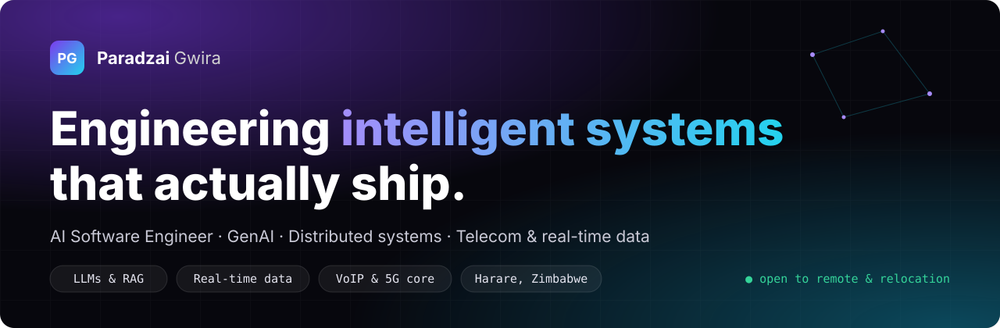

<a href="https://redemptionincsoftwares.co.zw/">
  
</a>

<p align="center">
  <a href="https://redemptionincsoftwares.co.zw/"></a>
  <a href="files/Paradzai-Gwira-AI-Software-Engineer-CV.pdf"></a>
  <a href="https://linkedin.com/in/paradzai-gwira-216169194"></a>
  <a href="mailto:paradzaigwira@gmail.com"></a>
  <a href="https://wa.me/263715336984"></a>
</p>

<p align="center">
  
</p>

<p align="center">
  <a href="#about">About</a> &nbsp;&middot;&nbsp;
  <a href="#what-i-build">What I build</a> &nbsp;&middot;&nbsp;
  <a href="#experience">Experience</a> &nbsp;&middot;&nbsp;
  <a href="#rd-lab--open-source">R&amp;D Lab</a> &nbsp;&middot;&nbsp;
  <a href="#apps-in-public-stores">Apps</a> &nbsp;&middot;&nbsp;
  <a href="#tech-stack">Stack</a> &nbsp;&middot;&nbsp;
  <a href="#how-i-work">How I work</a> &nbsp;&middot;&nbsp;
  <a href="#sponsorship--mentorship">Sponsor</a> &nbsp;&middot;&nbsp;
  <a href="#lets-ship-it">Contact</a>
</p>

---

## About

**Now:** AI Software Engineer at **Econet AI (Econet Wireless)**, Harare, Zimbabwe.

I'm Paradzai Gwira, a formally trained autodidact who builds intelligent systems for telecom, fintech and enterprise teams. University gave me the foundations (algorithms, discrete mathematics, system design), and every modern framework, language and tool I ship with, I taught myself, from SIP and 5G cores to Spring Boot and agentic AI. I learn fast, prototype like a research lab and ship to production.

| 5+ | 9+ | 5+ | 12 |
| :---: | :---: | :---: | :---: |
| years shipping production software | apps live in public app stores | domains: AI, telecom, fintech, loyalty, data | payment and operator integrations delivered |

```python
from paradzai import Engineer

pg = Engineer(
    role="AI Software Engineer",
    focus=["LLMs", "data", "platforms"],
    based_in="Harare, ZW",
    open_to=["remote", "relocation"],
)

pg.ship(your_idea)
# shipped to production
```

## What I build

> AI is only useful when it's wired into reliable systems. I work across the whole path: data in, intelligence in the middle, dependable software out.

| Capability | What it means in practice |
| --- | --- |
| **AI & automation** | LLM-backed assistants, RAG, AI agents, chatbots and WhatsApp automation that take on real customer and operational work, grounded in verified data. |
| **Production backends** | Secure, scalable services and REST / gRPC APIs with Java, Spring Boot, Python and Node.js. |
| **Real-time data** | Data warehouses fed by Debezium CDC over a Redpanda message bus into ClickHouse, for revenue assurance and reporting. |
| **Telecom & VoIP** | Call routing with OpenSIPS, real-time billing with CGRateS, 5G cores with Open5GS, and integrations with multiple mobile network operators. |
| **Mobile delivery** | 9+ apps shipped across Android, iOS, Huawei AppGallery and Web (PWA), from VoIP calling to loyalty and payments. |
| **Cloud & DevOps** | Linux, containers and CI/CD pipelines that keep production observable and boring. |

## Experience

<details open>
<summary><b>AI Software Engineer</b> &middot; Econet AI (Econet Wireless) &middot; <i>Jul 2026 - Present</i> &middot; Full-time, on-site</summary>

<br>

Leading the design of enterprise AI: generative AI, LLM, RAG and agent capabilities wired into telecom and business services.

- Architect enterprise AI solutions integrating generative AI, LLMs, RAG and AI agents
- Build scalable AI and data pipelines over large operational datasets
- Ship Java / Spring Boot and Python microservices that connect models to core systems
- Evaluate and productionise models for performance, reliability and cost
- Set AI engineering practice: evaluation, prompt engineering, monitoring and responsible AI

</details>

<details>
<summary><b>Mobile Full-Stack Developer</b> &middot; Points Africa &middot; <i>Oct 2025 - Present</i> &middot; Part-time, remote</summary>

<br>

Building a loyalty platform across PWA, Android and iOS, backed by secure, cloud-based APIs.

- Cross-platform loyalty apps in Flutter / Dart for PWA, Android and iOS
- Secure, scalable REST APIs and cloud / serverless backends with Node.js and Express
- Code reviews, bug triage, technical documentation and CI/CD across the full SDLC

</details>

<details>
<summary><b>Senior Software, VoIP & Data Engineer (Technical Lead)</b> &middot; Africom Telecommunications &middot; <i>Oct 2021 - Jun 2026</i></summary>

<br>

Led cross-platform VoIP products, then grew into data engineering and DevOps across the platform.

- Led VoIP apps for Android, iOS and Huawei devices and their SIP back ends, including **Taura**
- Architected real-time billing (CGRateS), SIP routing and call processing (OpenSIPS) and chatbot platforms
- Built an open-source, real-time data warehouse: Debezium CDC over Redpanda into ClickHouse
- Designed revenue assurance dashboards that helped control leakage through major core-network changes
- Delivered backends and payment modules for VoIP, messaging and payment apps serving thousands of users
- Deployed and maintained LTE 4G EPC infrastructure; mentored junior engineers

</details>

<details>
<summary><b>Full-Stack Developer</b> &middot; Umbai &middot; <i>Jun 2023 - May 2025</i> &middot; Contract, remote</summary>

<br>

Built payment platforms, chatbots, REST APIs and mobile products for African markets.

- Integrated 6 payment gateways and the services of 6 mobile network operators
- Built WhatsApp chatbots and business automations for service, sales and orders
- Developed .NET MAUI, C#, Vue.js and Angular apps on MVC microservices and REST APIs

</details>

<p>Full details: <a href="files/Paradzai-Gwira-AI-Software-Engineer-CV.pdf"><b>CV (PDF)</b></a> &middot; <a href="https://redemptionincsoftwares.co.zw/cv">online CV</a></p>

## R&D Lab & open source

| Project | Stack | What it is |
| --- | --- | --- |
| **Agentic AI & RAG for telecom** | LLMs &middot; RAG &middot; agents | LLM, retrieval and agent workflows grounded in enterprise data, with evaluation and guardrails built in. |
| **Real-time CDC data warehouse** | Debezium &middot; Redpanda &middot; ClickHouse &middot; Grafana | Open-source streaming warehouse keeping analytics in sync with operational databases for revenue assurance. |
| **5G core lab & 6G exploration** | Open5GS &middot; 5G SA &middot; 6G | Building 5G standalone networks on Open5GS, exploring emerging 6G features and growing an open-telecom community. |
| [**flutter_dtmf_pro**](https://github.com/PRedemption/flutter_dtmf_pro) | Dart &middot; Flutter plugin | Open-source plugin generating DTMF telephony tones on Android, iOS and Web for VoIP and communication apps. |
| [**Grounded portfolio assistant**](https://redemptionincsoftwares.co.zw/) | LLM &middot; Gemini &middot; React | An assistant that answers only from verified facts and hands off to a human when unsure. Try it on my portfolio. |

## Apps in public stores

Shipped to Android, iOS, Huawei AppGallery and Web (PWA):

- **Taura**: low-cost international calls to any mobile or landline; the person you call needs no internet or app. [Google Play](https://play.google.com/store/apps/details?id=org.duri.taura) &middot; [App Store](https://apps.apple.com/zw/app/taura/id1592996258)
- **Kurira**: cross-platform app for everyday voice and connectivity in African markets. [Google Play](https://play.google.com/store/apps/details?id=org.kurira.app) &middot; [App Store](https://apps.apple.com/ng/app/kurira/id1643459023)
- **Umbai Merchant**: payments and transaction management, backed by secure REST APIs. [Google Play](https://play.google.com/store/apps/details?id=com.umbai.app)
- Also: **Points Africa**, **Mobilielink**, **CatchApp**, **Maswerasei**, **Homekonnect**, **Hello Africa**

## Tech stack

<p align="center">
  
  <br>
  
  <br>
  
  <br>
  
</p>

| Area | Tools |
| --- | --- |
| **AI & ML** | Generative AI, LLMs, RAG, AI agents, prompt engineering, model evaluation, responsible AI, Python |
| **Backend & distributed systems** | Java, Spring Boot, Spring Cloud, Node.js, TypeScript, Go, C# / .NET, REST, gRPC, GraphQL, microservices, RabbitMQ |
| **Data & streaming** | Debezium CDC, Redpanda / Kafka, ClickHouse, data warehousing, Grafana, SQL |
| **Telecom & networks** | SIP / VoIP, OpenSIPS, CGRateS, LTE 4G EPC, Open5GS 5G core, 6G research, operator integrations |
| **Mobile & platforms** | Flutter / Dart, Kotlin, React Native, .NET MAUI, Android, iOS, Huawei HMS, PWA, Firebase, Codemagic, Shorebird OTA, Strapi CMS |
| **Cloud, DevOps & quality** | Docker, Kubernetes, Helm, Ansible, GitHub Actions, GitLab CI, Jenkins, AWS, Linux, TDD, JUnit, Jest |

## How I work

Everything goes through the same loop, and the bench is never empty:

1. **Learn**: university foundations, self-taught mastery from specs, RFCs, source code and docs. New stacks in weeks, not quarters.
2. **Prototype**: small, measured experiments in a lab setting before anything touches production.
3. **Deliver**: turn the winning experiment into clean, tested, observable systems.
4. **Ship**: monitor, and feed what I learned back into the next loop.

**Education:** BSc (Hons) Information Technology, Software Engineering, Bindura University of Science Education (2019 - 2023)
<br>
**Certification:** Oracle Certified Professional: Java SE 21 Developer (in preparation)
<br>
**Languages:** English (professional), Shona (native)

## Sponsorship & mentorship

I want to turn my lab into a launchpad: stronger open-source projects, and a mentorship program for young, energetic engineers who are hungry to learn. Sponsorship makes both sustainable.

- **Sponsors** fund open-source maintenance (like `flutter_dtmf_pro`), cloud credits and 5G lab hardware, published as open guides for the community.
- **Mentees**: if you're early in your career and willing to learn, tell me what you want to build.

Reach out at [paradzaigwira@gmail.com](mailto:paradzaigwira@gmail.com) or on [my portfolio](https://redemptionincsoftwares.co.zw/).

## Let's ship it

AI automation, data platforms or production backends: tell me what you're trying to change and let's figure out the fastest path to production.

<p align="center">
  <a href="https://redemptionincsoftwares.co.zw/"><b>Portfolio</b></a> &nbsp;&middot;&nbsp;
  <a href="files/Paradzai-Gwira-AI-Software-Engineer-CV.pdf"><b>CV (PDF)</b></a> &nbsp;&middot;&nbsp;
  <a href="https://linkedin.com/in/paradzai-gwira-216169194"><b>LinkedIn</b></a> &nbsp;&middot;&nbsp;
  <a href="mailto:paradzaigwira@gmail.com"><b>Email</b></a> &nbsp;&middot;&nbsp;
  <a href="https://wa.me/263715336984"><b>WhatsApp</b></a>
</p>

<p align="center"><sub>Client and company work lives in private repositories. Public repos here are side projects, prototypes and open-source tinkering.</sub></p>
